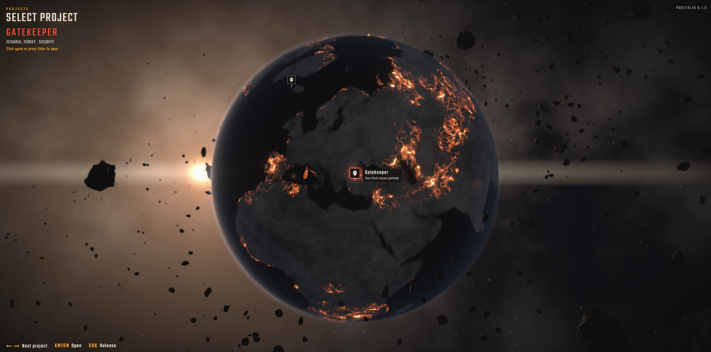

# Project Lobby


A project portfolio styled after the Call of Duty: Black Ops 2 Zombies menu. A cracked, burning globe floats in space; each marker on it is a project. Clicking a marker rotates the globe to face it, zooms in, and opens a pre-game style lobby with the project's settings, loadout (tech stack), and players (team).

## Run it

```
npm install
npm run dev
```

Then open the URL Vite prints (normally http://localhost:5173).

## Controls

- Drag the globe to rotate it. It spins slowly on its own while nothing is focused.
- Click a marker to focus it: the globe turns to bring that project round to the front and holds there.
- Click the focused marker again, or press Enter, to fly in and open its lobby.
- Left and right arrow keys focus the previous or next project (ordered west to east).
- Esc in the lobby returns to the focused globe. Esc again releases the focus so the globe spins freely.
- In the lobby: arrow keys or W/S to move, Enter to select, L for the live build, G for the source.

## Dev shortcut

Open a lobby directly, skipping the intro:

```
http://localhost:5173/?lobby=transit
```

Use any project id from `src/data/projects.ts`.

## Where things live

- `src/data/projects.ts` – the project list. Swap the dummy entries for real ones here. Each project has a `location` (city, country, lat, lon) for its marker, an `image` for the framed preview (drop yours into `public/projects/`), plus type, status, year, role, platform, license, stack, team, highlights and links.
- `src/scene/` – the Three.js scene: globe shader, debris, sun, markers, camera and globe motion.
- `src/ui/` – the HUD and the lobby screen (React + CSS).

## Stack

Vite, React, TypeScript, Three.js via React Three Fiber and drei, postprocessing (bloom, vignette), Framer Motion.
